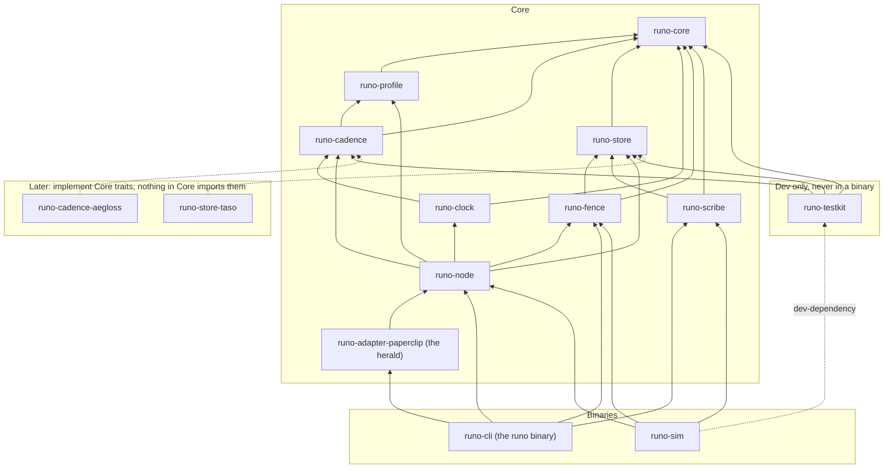

# Runo Core: Technical Specification

Nov 2, 2026 · @Jarmo

Runo Core is a Rust workspace of nine library crates (eight Core crates and the herald adapter), a dev-only testkit, a CLI and a simulator, that implements the Core layer of the Dwarven Song specification v3: signed per-task chains, the refrain, four clocks, a fenced store, a scribe and a node runtime — built against trait boundaries where every Later feature plugs in. This document is the build plan; the protocol itself is in the Song spec, and this document never restates a rule it can cite.

## 1. Scope and build order

Core implements everything the Song spec marks **Core**; Later features are reserved as traits, enum variants and version-gated fields, never as code paths. The rule for every design choice below: Later must be addable without changing a Core trait's signature, and any change to a Core wire type goes through the version rule in §3, which is authoritative.

| Implemented in Core | Reserved for Later |
| --- | --- |
| Verse, refrain, grant, activation, closure, roster, tome types with canonical encoding | Intent kinds (`offer`, `claim`, `handoff`) as reserved enum variants |
| Ed25519 signing against a fixed roster | `RosterGovernance` trait for live membership, pre-rotation, recovery |
| Ingress verification, pending buffer, fork index | — |
| Four clocks, escalation, suspicion with the vouch rule | `CadenceSource` trait: fixed in Core, Aegloss Later |
| Node runtime: refrain timer, probe loop, call ladder, recovery handoff | `IndependenceVerifier` trait for provider-side identity |
| **Routing layer**: the Paperclip adapter as a herald voice, and a human-facing `CallChannel` with per-lane dedup | — |
| `SongStore` with jsonl and in-memory backends behind one store service | Taso backend behind the same trait |
| Fencing: grant, activation, allocator client, resource guard, task lifecycle | Paperclip as the mine's fence allocator |
| Scribe: closure snapshot, manifest, Merkle root, addenda | — |
| Profiles and chorus manifest in TOML; CLI | Dashboard beyond the terminal view |
| Deterministic simulation and the fifteen scenarios; the replay harness | — |

**Build order** follows the proof plan: the replay (already runnable, no Runo code) → TLA+ model of claim, fence, relaunch and closure → crates in dependency order (§2) → simulation suite → Later. Each step has a gate in §14.

**Language and toolchain.** Rust 2024 edition, stable toolchain, `cargo` workspace. Async runtime `tokio` for the node, with all time and I/O behind traits so the same code runs under the deterministic simulator. No `unsafe` in Core crates (`#![forbid(unsafe_code)]`).

## 2. Workspace

One Cargo workspace, `runo/`, with nine library crates — eight Core crates and the herald adapter — a dev-only testkit, the CLI and the simulator in a strict layering: every crate depends only on crates drawn below it, and `runo-core` depends on nothing in the workspace.



*Crate dependency graph. Every arrow points down a layer; `runo-core` has none. The Paperclip adapter is a Core crate since the replay (its allocator side stays Later); `runo-testkit` is a dev-dependency only.*

| Crate | Owns | Depends on |
| --- | --- | --- |
| `runo-core` | Wire types, canonical CBOR, hashing, signing, ingress decisions, the shared fencing types (`Fence`, `FenceAck`, `Durability`, `RecordClass`), `Clock` and `Instant` | `serde`, `ciborium`, `blake3`, `ed25519-dalek` |
| `runo-profile` | Profile and manifest TOML, load-time checks | `runo-core`, `toml` |
| `runo-cadence` | `CadenceSource` trait, `FixedCadence` and `CorpusCadence` (§13); thresholds in `Millis`, factors in tenths | `runo-core`, `runo-profile` |
| `runo-store` | `SongStore` and its role traits (`VerseReader`, `VerseWriter`, `ResourceFenceStore`, `RefrainSlot`, `ScribeRead`), jsonl and in-memory backends, the resource fence store, the store service and client | `runo-core`, `tokio`, `serde_json` |
| `runo-clock` | `Chorus`, four clocks, escalation, suspicion | `runo-core`, `runo-cadence` |
| `runo-fence` | `Allocator`, `AllocatorJournal`, `FencedResource`, `StoreResource`, `FenceGuard`, `OpKey`, task lifecycle | `runo-core`, `runo-store` |
| `runo-node` | The voice runtime and its traits (`CallChannel`, `RecoveryAuthority`); the human `CallChannel` with dedup | all of the above |
| `runo-scribe` | `seal`, `verify`, addenda, the runner | `runo-core`, `runo-store` |
| `runo-adapter-paperclip` | The herald voice: Paperclip signals read from its database or API and sung as peer verses about lanes; Later, the fence allocator side | `runo-node`, `reqwest` (the Paperclip API first; JSONL import for offline diagnosis; no database adapter in Core — decision 8) |
| `runo-testkit` | Builders, fixture chorus, `SimClock`, `FailurePlan`, conformance macros (dev-dependency everywhere) | `runo-core`, `runo-store`, `runo-cadence` |
| `runo-sim` | Scenarios and the harness | `runo-node`, `runo-fence`, `runo-scribe`, `runo-testkit`; the protocol stage needs no simulator crate (a deterministic event queue, `SimClock`, `MemStore`), and the runtime-stage simulator is chosen when that stage starts (decision 9) |
| `runo-cli` | The `runo` binary | `runo-node`, `runo-scribe`, `runo-fence`, `runo-adapter-paperclip`, `clap` |

**The herald.** The Paperclip adapter is a voice like any other, with role `herald` in the mine profile. It keeps every board event it reads as a raw observation and sings only peer-family verses *about* lanes, and only when a threshold is crossed: a `blocked` run is recorded as the start of a wait and becomes `Suspect { about: lane, clock: Waiting }` when that wait is overdue, never on sight; a `failed` run with a kind that never self-clears becomes `Suspect { clock: Task }` at once; a recovery action becomes a `Vouch` or `Suspect` with its reason. It never sings `Boundary` or `Work` on a lane's behalf, because a singer sings only its own chain.

**Episodes.** Delivery to a person is organised in durable episodes, not messages, so that one stall is one conversation and a restart does not resend everything.

| Rule | Definition |
| --- | --- |
| Identity | `(lane, clock, opening verse hash)`; persisted in the node's state with its lifecycle |
| Opens | The first `Suspect` the ladder sings for that lane and clock while no episode is open for them |
| Updates | A higher escalation level on the same episode may produce one more notification; nothing else does |
| Resolves | A verse that clears the clock: new progress for `Progress`, a terminal boundary or `Close` for `Task`, a cleared `blocked_on` for `Waiting`, a fresh refrain or vouch for `Reachability`; or an owner `Ruling` on the lane |
| Reopens | A new crossing after resolution opens a new episode with its own identity; a later, separate stall is never folded into a resolved one |
| Retries | Delivery is idempotent by episode identity and level; after uncertain delivery the same message is resent, never a new one |

The human `CallChannel` delivers one message per episode and level: a comment on the lane in Paperclip and a push notification.

Later crates (`runo-store-taso`, `runo-cadence-aegloss`, and the allocator side of `runo-adapter-paperclip`) implement Core traits and sit beside the workspace or in it behind feature flags; nothing in Core imports them. `runo-testkit` is a dev-dependency only and never ships in a binary.

**Dependency policy.** Core crates take only `serde`, `ciborium`, `blake3`, `ed25519-dalek`, `tokio`, `toml`, `clap`, `thiserror`, `tracing`, and `proptest` for tests. The herald adapter adds `reqwest` (rustls with the system's root certificates, so the binary stays static and trusts what its host trusts), because the Paperclip API is the primary integration and JSONL import covers offline diagnosis (decision 8), and `serde_json` to read the board's JSON, tolerating fields it does not use. `runo-store` adds `serde_json` for the jsonl backend's human-readable lines (§7), so a song can be read with `grep` and the replay kit. `runo-node` uses the same `serde_json` for its episode state, so what was delivered to a person survives a restart and can be read by hand. `runo-node` also takes `reqwest` (the same rustls build) for its Telegram channel, the first human channel that reaches a phone; the bot token is read from an environment variable the operator names and never logged. The runtime-stage simulator crate is not yet chosen (decision 9). Anything else needs a line in this table saying why.

## 3. Data model

All wire types live in `runo-core` and are plain data: no trait objects, no lifetimes, `serde` derives only. A Later feature adds fields as `Option` or `#[serde(default)]` and adds enum variants at the end; it never removes or retypes.

```rust
pub struct Hash(pub [u8; 32]);             // a blake3 digest
pub struct VerseId(pub Hash);              // blake3 of the canonical bytes = `sum`
pub struct SingerId(pub String);
pub struct TaskId(pub String);
pub struct Epoch(pub u64);
pub struct RosterVersion(pub u32);
pub struct Millis(pub u64);                // every protocol duration: whole milliseconds, never a float (decision 6)

pub struct Verse { pub header: Header, pub payload: Payload, pub seal: Seal }

pub struct Header {
    pub v: u8,                        // 3; readers accept v <= their own and reject unknown fields
    pub singer: SingerId,
    pub roster: RosterVersion,
    pub task: TaskId,
    pub epoch: Epoch,
    pub grant: Option<VerseId>,       // the Grant verse; None only on unfenced chains (peer and record kinds)
    pub seq: u64,
    pub prev: Option<VerseId>,
    pub cause: Option<VerseId>,
    pub progress: Progress,           // { height: u64, head: Option<Hash> }
    pub sung_at: Timestamp,           // advisory
    pub note: Option<String>,         // one line
}

pub enum Payload {
    // self
    Claimed    { task: TaskSpec, promise: Promise },
    Boundary   { event: String, state: Option<Ref>, blocked_on: Option<String> },
    Work       { step: String, changed: Vec<Ref>, head: Option<Hash> },
    // peer
    Ack        { about: About },
    Vouch      { about: About, how: VouchHow },
    Suspect    { about: About, clock: Clock, overdue_by: Millis },
    Ruling     { about: About, verdict: Verdict, reason: Option<String> },
    // record: allocator only
    Grant      { holder: SingerId, task: TaskId, epoch: Epoch, resources: Vec<ResourceId> },
    Activation { grant: VerseId, acks: Vec<ResourceAck> },   // ResourceAck { resource, epoch, durable: bool }: the wire form of a FenceAck (§8)
    Close      { task: TaskId, snapshot: Ref },            // ClosureSnapshot blob (§9)
    Tome       { close: VerseId, manifest: Ref, root: Hash },
    Addendum   { tome: VerseId, verse: VerseId },
    // record: owner only
    Roster     { version: RosterVersion, roster: Ref },
    // Later, reserved: Offer, Claim, Handoff — ingress rejects them until enabled
}

pub struct Seal { pub sum: VerseId, pub sig: Signature }

pub struct Refrain {
    pub singer: SingerId, pub task: TaskId, pub epoch: Epoch,
    pub n: u64, pub last: VerseId, pub progress: Progress,
    pub sent_at: Timestamp, pub sig: Signature,
}

pub struct Promise { pub unit: String, pub cadence: Cadence, pub checkpoints: bool, pub source: String }
pub struct Cadence { pub call: Millis, pub again: Millis, pub suspect: Millis }   // absolute, computed at claim time: ceil(base × tenths / 10) (decision 7)
pub struct About { pub singer: SingerId, pub task: Option<TaskId>, pub epoch: Option<Epoch>, pub hash: Option<VerseId> }
```

| Concern | Choice | Why |
| --- | --- | --- |
| Canonical encoding | CBOR, deterministic (RFC 8949 §4.2: sorted keys, shortest ints, no indefinite lengths), via `ciborium` with a sorting wrapper | One byte sequence per value, so `sum` is reproducible on any node |
| Hash | blake3, 32 bytes, prefixed `b3:` when printed | Fast, keyed-hash available for fingerprints |
| Signature | Ed25519 via `ed25519-dalek`, over `sum` | Small keys, fast verify, hardware-token support |
| Timestamps | RFC 3339 UTC strings on the wire; `u64` nanoseconds internally | Advisory only, so readability wins |
| Refs | `Ref { scheme, path, hash }` — e.g. `taso://vessels/session/51734` with its content hash | Large state by reference, verifiable |

**Sum and signature.** `sum = blake3(canonical(header, payload))`; `sig = sign(sum)`. Verification recomputes `sum` from the decoded fields, never trusts the carried one, then checks `sig` against the key the `roster` version binds to `singer`.

**Grants, activations, closures, rosters and tomes** are themselves verses, so they need no second signing scheme; ingress checks their kind against the singer's role (§4). The roster document and closure snapshot are stored as referenced blobs (CBOR) whose hash the verse carries.

```rust
pub struct RosterDoc {
    pub version: RosterVersion,
    pub voices: Vec<VoiceEntry>,      // { singer, key: VerifyingKey, role, domains: Domains, fenced: Vec<ResourceId> }
    pub allocator: SingerId,
    pub owner: SingerId,
    pub run: RunId,                   // the run this version authorizes; archived verses verify by the version they name
}

pub struct ClosureSnapshot {         // written by the allocator at Close; immutable
    pub task: TaskId,
    pub grants: Vec<VerseId>,         // every Grant issued for the task
    pub chains: Vec<ChainEnd>,        // { singer, epoch, last_seq: Option<u64>, last_hash: Option<VerseId> } per grant
    pub forks: Vec<(ChainKey, Vec<VerseId>)>,   // from the fork index, not from walking heads
}

pub struct TomeManifest {
    pub close: VerseId,
    pub snapshot: ClosureSnapshot,    // copied, so the tome is self-describing
    pub summary: Summary,             // verse_count, final_progress, outcome, net_time, waits
}
```

**Compatibility.** Canonical encoding is strict: a v3 reader rejects a verse with an unknown field, because an ignored field would still be under the signature and two readers would disagree about what was signed. New fields therefore arrive only with a version bump, and a reader accepts `v` up to its own. `Option` and `#[serde(default)]` are for Later *values* within v3's field set, not for new fields.

## 4. Ingress and chains

Every verse that reaches a node — from the local singer, from replication, or from a read — passes one pipeline in `runo-core::ingress`. It is pure: it takes the verse, the roster history and a view of the store, and returns a decision. The node applies the decision; nothing in the pipeline does I/O.

```rust
/// How the store classified a record on admission (§7). In runo-core, so Stored can name it.
pub enum RecordClass { Current, History, Control }

pub enum Decision {
    Append { key: ChainKey, fork_of: Option<VerseId> },
    Stored { class: RecordClass },               // byte-identical verse already in storage, under the class it was first admitted with (decision 10)
    Pending { waiting_for: Vec<VerseId> },      // prev, cause, grant or activation not yet known
    History,                                     // structurally valid, but epoch below the installed fence: archive only
    Control,                                     // allocator record (Close, Tome, Addendum) on a closed task: record, no effects
    Reject(RejectReason),
}

pub struct Incident { pub claimed_singer: SingerId, pub reason: RejectReason, pub via: Transport }

/// The synchronous validation facts ingress needs from the store, without I/O (decision 2).
/// Reads for sealing are a different contract, ScribeRead (§7).
pub trait IngressView {
    fn stored_class(&self, id: &VerseId) -> Option<RecordClass>;      // step 2 reads the class, never decides one
    fn get(&self, id: &VerseId) -> Option<Verse>;
    fn variants(&self, key: &ChainKey, seq: u64) -> Vec<VerseId>;
    fn installed_fence(&self, singer: &SingerId, task: &TaskId) -> Option<Epoch>;
    fn task_state(&self, task: &TaskId) -> TaskState;
    fn has_activation(&self, grant: &VerseId) -> bool;
}

pub fn admit(v: &Verse, rosters: &dyn RosterHistory, view: &dyn IngressView) -> Decision;
```

**Two deduplications, not one.** `Stored` is storage's answer: this content hash is already appended, under the class it was first admitted with (§7). It says nothing about whether *this reader* has seen the verse. Each node keeps its own observer cursor over the store, and a verse is observed exactly once per node when that cursor first passes it, whether the decision was `Append` or `Stored`; a `Stored` record with class `History` is observed as history, never as live. Repeated reads behind the cursor have no effect. Two nodes reading one stored `Claimed` verse therefore each establish the task once and never reset it afterwards.

**Startup replay.** On start, a node reads the store from the beginning with `replay = true`: chain state and waiting spans are reconstructed from historical verses, but reachability is *not* — `reach_since` is set to the node's own start time, so historical records never pretend to prove current reachability. Task clocks cannot be rebuilt from verses alone, because their elapsed time was measured on this node's monotonic clock: the node therefore **persists an elapsed-time checkpoint per open task on every tick** (`$RUNO_HOME/state/clocks.jsonl`, replaced atomically), and on restart resumes each task clock from its checkpoint plus a documented grace of one probe interval. A task with no checkpoint (the node is new) starts its clock at the restart and shows the task as *age unknown* until the next promise. Only verses and refrains that arrive after the cursor reaches the store's head count as live observations.

| Step | Check | On failure |
| --- | --- | --- |
| 1 | `v <= 3`; no unknown fields; payload kind enabled in this build | `Reject(Unknown)` — reserved Later kinds land here |
| 2 | Byte-identical verse already stored | `Stored` (still observable, above) |
| 3 | Roster version exists; `singer` is in it; key resolves | `Reject(UnknownSinger)` |
| 4 | Recomputed `sum` equals carried `sum` | `Reject(BadSum)` |
| 5 | `sig` verifies under that key | `Reject(BadSig)` |
| 6 | Kind allowed for the singer's role: `Roster` only from the roster's owner; `Grant`, `Activation`, `Close`, `Tome`, `Addendum` only from its allocator | `Reject(Privilege)` |
| 7 | For an effect on the current run (anything but archival), the named roster version is the one in force for this run | `Reject(StaleRoster)` |
| 8 | `prev`, `cause`, `grant` (and the grant's `Activation`) all known to the store | `Pending` with the missing ids |
| 9 | `prev` belongs to the same `(singer, task, epoch)`; `seq == prev.seq + 1`, or `seq == 0` with `prev == None` | `Reject(BadChain)` |
| 10 | `Activation`: signed by the allocator, names an existing `Grant`, and its acks cover every resource that grant lists | `Reject(BadActivation)` |
| 11 | Fenced chain: `grant` is a `Grant` by the allocator for this `(singer, task, epoch)` with a valid `Activation` | `Reject(BadGrant)` |
| 12 | Task is `Closed` and the kind is `Close`, `Tome` or `Addendum` from the allocator | `Control` |
| 13 | `epoch >= installed fence` for `(singer, task)`, and the task is not `Closed` | `History` |
| 14 | Key `(singer, task, epoch, seq)` already holds a different hash | `Append { fork_of }` and a fork report |

Structural checks (1–11) complete before the fence decisions (12–13), so a `History` verse is always a well-formed verse.

A `Reject` is recorded locally as an `Incident` and shown in the view. It never makes the node sing `Suspect`: a bad signature proves only that someone sent bytes naming that singer, not that the singer sent them, and integrity is not one of the four clocks. `Pending`, `History`, `Control` and `Stored` are silent.

**Pending buffer.** Bounded per singer (default 256 verses, oldest evicted with a log line). When a missing verse arrives, every pending verse that waited on it is re-admitted in `seq` order. The node asks the store or a peer for a missing id with `fetch(VerseId)`; Core fetches from storage only, so a verse unknown to storage stays pending until replication brings it.

**Chain index.** The store keeps, per `(singer, task, epoch)`: head `(seq, hash)`, and per `(singer, task, epoch, seq)` the set of hashes (one, or several on a fork). `head(singer, task)` returns the highest epoch's head. Forks are never resolved by Core; they are reported, kept, and listed in the tome.

**Refrain ingress** is a shorter path: roster lookup, signature over the canonical refrain bytes, and `n` strictly greater than the last seen for that chain; otherwise the refrain is dropped without a decision. A valid refrain updates only the reachability observation and the latest-refrain slot.

## 5. Clocks and suspicion

`runo-clock` is a pure state machine: feed it observations and a monotonic `now`, read back clock states and suspicion. It never reads the wall clock, which is what lets the simulator drive it.

```rust
pub enum Clock { Reachability, Progress, Task, Waiting }
pub enum Observation<'a> {
    Refrain(&'a Refrain),                 // reachability only, if n advanced
    Verse(&'a Verse),                     // reachability; progress if height/head advanced; task on Claimed
    Vouch { about: &'a About, from: &'a SingerId },
    SuspectHeard { about: &'a About, clock: Clock, from: &'a SingerId },
    Inferred { singer: &'a SingerId, task: &'a TaskId, what: Evidence<'a> }, // Watch mode only
}
// What a board can show about a lane, fed to the same rules as the lane's own verses (§15):
// never a verse in the lane's name, never proof of reachability.
pub enum Evidence<'a> { Started(&'a Promise), Progressed(u64), Blocked(&'a str), Unblocked, Ended }

pub struct PeerClocks {
    reach_since: Instant, progress_since: Instant,
    task: Option<TaskClock>,              // { claimed_at, promise, waits: Millis, checkpoints: bool }
    waiting: Option<Instant>,             // set while blocked_on is present
    last_refrain_n: u64, last_height: u64,
    suspicion: [Level; 4],                // per clock: Quiet, Called, CalledAgain, Suspected
    vouches: Vec<(SingerId, Instant)>,    // recent, reachability only
}

impl Chorus {
    pub fn observe(&mut self, now: Instant, from: &SingerId, o: Observation);
    pub fn tick(&mut self, now: Instant) -> Vec<Escalation>;   // what crossed a threshold since last tick
}
pub struct Escalation { pub peer: SingerId, pub task: Option<TaskId>, pub clock: Clock, pub level: Level, pub overdue_by: Millis }
```

**Rules, as code paths.**

| Rule (Song spec §5) | Where |
| --- | --- |
| Only new work resets progress | `observe(Verse)` compares `height`/`head` to `last_height`; equal → reachability only |
| Refrain with `n` not advanced is ignored | `observe(Refrain)` early return |
| Task clock never resets within an epoch; waits subtract, including the wait in progress | `TaskClock.elapsed(now) = now - claimed_at - completed_waits - active_wait(now)`, where `active_wait(now) = now - waiting_since` while blocked and `0` otherwise; a new `Claimed` with a higher epoch replaces the clock |
| `blocked_on` pauses task, starts waiting | `observe(Verse)` on a `Boundary` with `blocked_on` sets `waiting_since` if unset; repeated waiting observations keep the original start |
| Clearing a block | A `Boundary` without `blocked_on` after one with it moves `now - waiting_since` into `completed_waits` exactly once and clears `waiting_since`; task time resumes from its pre-wait value |
| Completion | A terminal `Boundary` (per the profile's state machine) or `Close` drops `task` and `waiting_since` and stops progress, task and waiting escalation; reachability continues until the refrain stops |
| No-checkpoint promise disables progress escalation | `tick` skips `Progress` when `task.checkpoints == false` |
| Old-epoch, `History` and replayed verses never touch live clocks | `observe` ignores any verse whose epoch is below the peer's current epoch, and startup replay never sets `reach_since` (§4) |
| Each verse observed once per node | The observer cursor (§4); `Stored` verses ahead of the cursor are observed, verses behind it are not |
| Vouch lowers reachability only, and only once | A vouch is consumed when applied: `tick` lowers `suspicion[Reachability]` one level if an unconsumed vouch from an independent voice is newer than `reach_since`, then marks it consumed; vouches older than one cadence are dropped |
| Probe replies bind the challenge | `ProbeReply { challenge, singer, epoch, sig }` is an observation only if the challenge matches an outstanding one and `epoch` is the peer's current epoch |
| Thresholds | `tick` compares each clock's elapsed to the promise's absolute `call`, `again`, `suspect` thresholds in milliseconds, each ceil(base × tenths / 10) and refused at load if it overflows |
| Independence weighting | `Vouch` from a voice sharing a declared domain counts half; from the same domain set, not at all |

**Acceptance test for waiting.** A lane blocks for longer than its task deadline: only the waiting clock escalates. When it resumes, task elapsed continues from the value it had when the block began.

**Integrity is not a clock.** Signature and chain failures are `Incident`s (§4) with their own counter in the view; `Clock` has exactly four variants and `Suspect { clock }` names one of them.

**Time.** `Instant` is `runo_core::time::Instant`, a newtype over `u64` nanoseconds from a `Clock` trait with two implementations: `MonotonicClock` (std) and `SimClock` (the simulator advances it). Wall time appears only in `sung_at` and in the view.

**Suspicion output.** `tick` returns escalations exactly once per crossing. The node turns them into the call ladder (§6). Suspicion is per `(peer, task, clock)`; the view aggregates to one row per voice, worst clock first.

## 6. Node runtime

`runo-node` is one voice: it owns a key, a profile, a store handle and the chorus state, and runs four loops. Everything it touches outside the process goes through a trait, so a node runs unchanged under the simulator.

```rust
pub struct Node<S: SongStore, C: CallChannel, R: RecoveryAuthority, K: Clock> { /* ... */ }

#[async_trait] pub trait CallChannel {        // the consumer's direct channel: tmux, HTTP, Paperclip comment
    async fn call(&self, to: &SingerId, msg: Call) -> Result<(), CallError>;
    async fn probe(&self, to: &SingerId, challenge: [u8; 16]) -> Result<ProbeReply, CallError>;
    async fn ask_probe(&self, via: &SingerId, target: &SingerId) -> Result<(), CallError>;   // indirect
}
#[async_trait] pub trait RecoveryAuthority {  // the fence allocator's door
    async fn report(&self, s: SuspicionReport) -> Result<(), AuthError>;   // Core: report only; it decides
}
```

| Loop | Interval | Does |
| --- | --- | --- |
| **Sing** | On demand from the consumer's API (`sing(payload)`) | Builds the header from chain state, signs, `append`/`append_fenced` at the profile's durability, then announces. Listens first (below). Re-sings verses that ask to be heard until an `Ack` arrives, with backoff capped at the profile's cadence. |
| **Refrain** | Profile `refrain_interval` while a task is claimed | Signs `Refrain { n += 1, last, progress }` and calls `store.refrain`. Stops on task end, failure or a new `Claimed`. |
| **Probe** | Profile `probe_interval` (default half the shortest cadence) | `read_since(cursor)` → `admit` each verse → `chorus.observe`; latest refrains → `observe`; `chorus.tick(now)` → escalations → the ladder. |
| **Watchdog** (sentinel profile only) | Profile `silence_window` | If no verse or refrain from any voice but itself in the window, `RecoveryAuthority::report(ChorusSilent)`. |

**Listen before singing.** `sing` runs one probe iteration first, so a verse is always built on the latest chain head and a voice never sings past a suspicion it has not yet seen.

**The call ladder**, driven by `Escalation` levels from §5:

1. `Called` → `CallChannel::call` with the clock, the promise and the elapsed time, in one line.
2. `CalledAgain` → `call` again; for reachability, also `probe` directly and, on failure, `ask_probe` through one independent voice, which sings `Vouch` or `Suspect` on the node's behalf.
3. `Suspected` → the node sings `Suspect { clock, overdue_by }` and sends `RecoveryAuthority::report` with its suspicion and the vouches and suspects it holds from others. **It does nothing else.** Relaunch, if any, is the authority's decision and arrives as a `Grant` followed by an `Activation`.

**Acks.** The node acks only verses whose kind asks to be heard (§4 of the Song spec); `Ack`, `Vouch`, `Suspect` and refrains are never acked. An ack carries the full `About` with the verse hash.

**Errors.** A failed `append` is not a sung verse: the sing call returns the error and nothing is announced. The refrain loop keeps running, because the worker may be reachable while durable storage is broken and the protocol wants that distinction visible: peers see reachability continue and progress stall, which is exactly the gray case. The node also sings nothing about its own store failure; the store service reports it in `runo view` and the allocator's node sees it as `StoreError` on its own appends.

**Concurrency.** One task per loop under `tokio`; chorus state behind a single `Mutex` (it is small and every operation is sub-millisecond). The store trait is `Send + Sync`; backends serialize internally.

## 7. Storage

`runo-store` defines the trait from the Song spec §6 and ships two backends. Taso is a third, Later, behind the same trait.

**Ownership.** In Core exactly one process owns a chorus's store: the **store service** (`runo store serve`), which opens the backend and exposes the trait over a transport — a Unix socket on the host, and TCP on the chorus's private network (WireGuard in the mine) for voices on other hosts. Nodes and CLI commands never open the backend themselves; they hold a `StoreClient` that implements `SongStore` over the transport. This makes `append_fenced`'s atomic step a single-process critical section regardless of how many voices or hosts there are, at the cost of one store host per chorus in Core. Taso removes that single host Later; the trait and the client do not change.

```rust
/// How the store classified a record on admission (runo-core::ingress). Persisted beside the
/// verse's unchanged bytes; the signed bytes themselves never carry local state.
pub enum RecordClass { Current, History, Control }

/// What a read returns: the verse exactly as sung, plus what this store knows about it.
pub struct Record { pub verse: Verse, pub class: RecordClass, pub cursor: Cursor }

// Durability, Fence and FenceAck are runo-core::fence types (§8), re-exported here.

// Role traits (CLAUDE.md: callers take the role they need, never the whole store).
#[async_trait] pub trait VerseReader: Send + Sync {
    async fn read_since(&self, cursor: Cursor) -> Result<(Vec<Record>, Cursor), StoreError>;
    async fn get(&self, id: &VerseId) -> Result<Option<Record>, StoreError>;
    async fn head(&self, singer: &SingerId, task: &TaskId) -> Result<Option<Head>, StoreError>;
    async fn get_blob(&self, h: &Hash) -> Result<Option<Vec<u8>>, StoreError>;
}
#[async_trait] pub trait VerseWriter: Send + Sync {
    // --- current work: authority validated, fence enforced atomically; persists Current ---
    async fn append(&self, v: &Verse, level: Durability) -> Result<Receipt, StoreError>;          // unfenced chains only
    async fn append_fenced(&self, v: &Verse, level: Durability) -> Result<Receipt, FenceError>;   // fenced chains
    // --- historical evidence: validated, bytes kept unchanged, no effects, no live clocks; persists History ---
    async fn archive(&self, v: &Verse, level: Durability) -> Result<Receipt, StoreError>;         // for Decision::History
    // --- control records: allowed on a closed task, allocator only; persists Control ---
    async fn record(&self, v: &Verse, level: Durability) -> Result<Receipt, StoreError>;          // for Decision::Control
    async fn put_blob(&self, bytes: &[u8]) -> Result<Hash, StoreError>;
}
/// The store's own installed fences and task lifecycle: the song as the first fenced resource
/// (decisions 3 and 5). The allocator's reservations and closure record are a different contract,
/// AllocatorJournal in runo-fence (§8); the two may share a backend.
#[async_trait] pub trait ResourceFenceStore: Send + Sync {
    async fn install_fence(&self, grant: &Verse) -> Result<FenceAck, StoreError>;   // a Grant (epoch) or a Close (Closed); durable before the ack; never lowers
    async fn installed_fence(&self, singer: &SingerId, task: &TaskId) -> Result<Option<Fence>, StoreError>;
    async fn task_state(&self, task: &TaskId) -> Result<TaskState, StoreError>;                   // Open | Closing | Closed
}
#[async_trait] pub trait RefrainSlot: Send + Sync {
    async fn refrain(&self, r: &Refrain) -> Result<(), StoreError>;
    async fn latest_refrains(&self) -> Result<Vec<Refrain>, StoreError>;
}
/// Reads for sealing and verification (§9; decision 2): the snapshot a Close names, blobs, and
/// every record of a task including its history. Distinct from runo_core::ingress::IngressView.
#[async_trait] pub trait ScribeRead: Send + Sync {
    async fn snapshot(&self, close: &VerseId) -> Result<Option<Vec<u8>>, StoreError>;
    async fn blob(&self, h: &Hash) -> Result<Option<Vec<u8>>, StoreError>;
    async fn task_records(&self, task: &TaskId) -> Result<Vec<Record>, StoreError>;
}

/// The whole store: the sum of the role traits.
pub trait SongStore: VerseReader + VerseWriter + ResourceFenceStore + RefrainSlot + ScribeRead {}
```

One API, three routes. The node picks the route from the ingress decision: `Append` goes to `append` or `append_fenced` by chain kind, `History` to `archive`, `Control` to `record`. The store enforces the routing too: `append` refuses fenced chains, `append_fenced` refuses stale or closed work, `archive` refuses anything that is not below the installed fence or on a closed task, and `record` accepts only allocator kinds. Each route persists the `RecordClass` beside the verse (in jsonl, a wrapper object per line: `{"class": "history", "verse": …}`; the verse bytes inside are untouched), so a reader's observer skips `History` for live clocks and the scribe finds addenda, and storage deduplication never erases whether a record was evidence or work: a byte-identical re-admission returns `Stored` **with the persisted class**, which is why the `Stored` check in §4 reads the class rather than deciding one.

**Durability levels.** `append` returns only when the level is met. A backend that cannot provide a level returns `StoreError::Unsupported(level)` at open time, not at append time, so a profile asking for `Replicated(2)` on a jsonl store fails at `runo init`.

### jsonl backend

One directory per chorus. Human-readable, grep-able, and the format the replay harness already understands.

| File | Content | Durability |
| --- | --- | --- |
| `song.jsonl` | One verse per line, JSON of the canonical CBOR (same field order), appended in arrival order | `Host`: `write` + `fsync` per append, directory fsynced on creation |
| `fences.jsonl` | One line per installed fence `{singer, task, epoch, grant, at}`; the highest epoch per key wins on load | `Host`: fsynced before `install_fence` returns its ack |
| `refrains/<singer>/<task>.json` | The latest refrain for that chain, replaced atomically (write temp, rename) | `Process` is enough; refrains are not evidence |
| `blobs/<hash>` | Roster documents, tome manifests | `Host` |
| `index/` | Rebuilt on open from `song.jsonl`: chain heads, per-key hash sets, pending set | Derived; deleted and rebuilt if corrupt |

`append_fenced` on jsonl runs inside the store service's single writer: it reads the installed fence from memory (loaded from `fences.jsonl` at open), compares, and appends under the same lock, which is the atomic step. `append` refuses any chain that has an installed fence (`FenceError::Fenced`), so the ordinary path cannot bypass the guard. Opening a jsonl directory from a second process is refused by a lock file.

### In-memory backend

`MemStore` implements the trait over `BTreeMap`s with an injectable `FailurePlan` (fail the next N appends, drop every other refrain, forget fences on "restart" unless the plan says they persisted). It is the simulator's store and the unit tests' store; it has no durability beyond `Process` and says so.

### Taso backend (Later)

`runo-store-taso` maps `append` to a Taso chronicle append at the requested replication, `install_fence` to a sealed, replicated fence record, and `append_fenced` to Taso's conditional append (compare the installed fence and append in one transaction on every replica that accepts writes). The trait does not change; the durability table gains `Replicated(k)`.

## 8. Fencing

`runo-fence` has two halves: the allocator client a control plane uses to grant epochs, and the guard a resource embeds to enforce them. The song store is the first guarded resource; the mine's merge gate is the second.

```rust
// Shared types, in runo-core (decisions 1 and 4): every crate that installs, acknowledges or
// reads a fence speaks these; nothing in core does I/O.
pub enum Durability { Process, Host, Replicated(u8) }
pub enum Fence { Epoch(Epoch), Closed }          // Closed is above every epoch: nothing writes after it
pub struct FenceAck {                             // explicit: never supplied from the caller's context
    pub resource: ResourceId,                     // which resource persisted it
    pub grant: VerseId,                           // the Grant it answers; the Close verse for Fence::Closed
    pub fence: Fence,                             // the fence now enforced
    pub durability: Durability,                   // reached before this ack
}

// Allocator side, in runo-fence: the control plane holds the allocator key and runs this.
pub struct Allocator<S: SongStore, J: AllocatorJournal> { /* key, store, journal, resources: Vec<Box<dyn FencedResource>> */ }
impl<S: SongStore, J: AllocatorJournal> Allocator<S, J> {
    /// Reserve the next epoch (persisted), sing Grant, install at every resource, sing Activation.
    /// Serialized per (singer, task); a duplicate request while one is pending returns the pending grant.
    pub async fn relaunch(&self, singer: &SingerId, task: &TaskId) -> Result<Outcome, FenceError>;
    /// Close the task: install Closed at every resource, write the ClosureSnapshot, sing Close.
    pub async fn close(&self, task: &TaskId) -> Result<Verse, FenceError>;
}
pub enum Outcome { Activated { grant: VerseId, activation: VerseId }, NotActivated { grant: VerseId, missing: Vec<ResourceId> } }

/// The allocator's own durable state (decision 5): reservations, pending grants, task lifecycle,
/// the closure record with its snapshot hash. Distinct from the store's ResourceFenceStore even
/// where they share a backend; this is what a crashed allocator resumes from.
#[async_trait] pub trait AllocatorJournal: Send + Sync {
    async fn reserve(&self, singer: &SingerId, task: &TaskId) -> Result<Epoch, FenceError>;   // pending one returned, never a new one
    async fn granted(&self, singer: &SingerId, task: &TaskId, grant: VerseId) -> Result<(), FenceError>;
    async fn abandoned(&self, singer: &SingerId, task: &TaskId, epoch: Epoch) -> Result<(), FenceError>;
    async fn task_state(&self, task: &TaskId) -> Result<TaskState, FenceError>;
    async fn set_task_state(&self, task: &TaskId, state: TaskState, grants: &[VerseId]) -> Result<(), FenceError>;
    async fn closure_snapshot(&self, task: &TaskId, hash: Hash) -> Result<Hash, FenceError>;  // first hash wins
}

// Resource side: anything that accepts writes on behalf of a task.
#[async_trait] pub trait FencedResource: Send + Sync {
    fn id(&self) -> ResourceId;
    /// Persist (singer, task) -> max(fence, existing) with the authorizing verse's id; never lowers.
    /// grant is the Grant for an epoch fence, the Close verse for Fence::Closed.
    async fn install(&self, singer: &SingerId, task: &TaskId, fence: Fence, grant: VerseId) -> Result<FenceAck, FenceError>;
}
/// The song store as a fenced resource (decision 3): the one adapter between FencedResource::install
/// and the store's own install_fence(&Verse). It fetches the authorizing verse by id, checks it is a
/// Grant for (singer, task) at the requested epoch (or the task's Close for Closed), then delegates.
pub struct StoreResource<'a> { pub store: &'a dyn ResourceFenceStore, pub id: ResourceId }

pub struct FenceGuard { /* over a ResourceFenceStore: (singer, task) -> (Fence, grant) */ }
impl FenceGuard {
    /// The atomic check every write path calls, inside the same critical section as the write.
    /// Requires the grant to be installed here AND an Activation for it to be known.
    pub fn admit(&self, singer: &SingerId, task: &TaskId, epoch: Epoch, grant: &VerseId, activation: &VerseId) -> Result<(), FenceError>;
}
```

**Relaunch sequence.** Numbered so the TLA+ model and the simulator can name each step.

1. The authority decides to relaunch (on a `SuspicionReport`, outside Runo's control). Requests for the same `(singer, task)` are serialized; a second request while one is in flight returns the first's pending grant, so the race test's "exactly one epoch" is a rule, not luck.
2. `Allocator::relaunch` reserves `epoch = reserved + 1` in its own persisted `AllocatorJournal` **before** anything else. A crash after this step resumes from the reservation; the epoch is never reused.
3. It sings `Grant { holder, task, epoch, resources }`. The grant's hash is now known.
4. For every resource in `resources`: `install(singer, task, Fence::Epoch(epoch), grant_id)`. Each resource persists the fence at `Host` or better, refuses to lower an existing higher fence, and returns `FenceAck { resource, grant, fence: Epoch(epoch), durability }` — every field explicit, none supplied from the allocator's own context.
5. If any resource fails to acknowledge, the allocator stops and returns `NotActivated`. The grant stays in the song, unactivated; no replacement starts. A later retry reinstalls on the missing resources and continues from step 6 with the same grant.
6. With every ack in hand, it sings `Activation { grant, acks }` and only then starts the replacement with the grant id.
7. The replacement's first verse is `Claimed` with `grant` set; every write it makes carries the grant, and every guard requires both the installed grant and a known `Activation` for it.
8. The old incarnation's later writes carry epoch `n-1`: every guard rejects them, the store files their verses as `History`.

**Grant validation in the guard.** A write is admitted if its `grant` is installed at this resource for `(singer, task, epoch)` and an `Activation` naming that grant is known. An `Activation` is valid only if it is signed by the allocator, names an existing `Grant`, and its acks cover every resource that grant lists. The guard caches validated pairs; an unknown grant or activation is fetched from the store before the write is admitted, and a write whose grant cannot be fetched is refused, not queued.

**Task lifecycle.** The allocator keeps a durable state per task: `Open → Closing → Closed`. Relaunch is serialized per `(singer, task)`, but closure spans every singer on the task, so the two are serialized against each other at task scope, and the closure snapshot is captured once and reused on every retry — a fixed grant set does not imply fixed chain heads, because delayed records keep entering the archive.

1. `close` writes `Closing` to the allocator's `AllocatorJournal`. From that moment no new reservation or activation for any singer on that task is accepted.
2. **Settle reservations.** Every reservation in flight either becomes a grant (its `Grant` verse is appended) or is durably marked abandoned in the `AllocatorJournal` after a bounded wait (the profile's `reservation_timeout`, 60 s by default). Only then is the grant set frozen and written to the log.
3. **Close resources.** Install `Fence::Closed` at every resource named by any grant in the frozen set; each persists and acknowledges.
4. **Capture the snapshot once.** At a defined store boundary — the store cursor at the moment every `Closed` ack is in — read the chain heads and the fork index for the frozen grants, build the `ClosureSnapshot`, store it as a blob, and **persist its hash in the closure record of the `AllocatorJournal`** before anything else.
5. Sing `Close { task, snapshot }` naming that hash, and write `Closed`.

**Crash recovery.** On restart the allocator resumes from the recorded step. If the snapshot hash is already in the closure record, steps 4–5 reuse that exact blob; the snapshot is never recomputed, even if a late fork has since entered the archive. If it is not, the allocator is before step 4 and proceeds from the frozen grant set. The crash test for this is `close-crash`: crash between snapshot persistence and `Close`, with a late archived fork arriving before restart; the published snapshot must equal the persisted one.

Closure stops work: anything arriving for the task afterwards is `History` at the store and refused at every other resource. The protocol's own records — `Close`, `Tome`, `Addendum` — still land on a closed task through `record`. A closed task is never reopened; follow-up work is a new task with `cause` = the `Close` verse.

**Persistence.** `FenceGuard` is generic over a `ResourceFenceStore` (jsonl file in Core; a Taso record Later). On restart it reloads and takes the maximum epoch per key, so a crash between install and ack cannot lower a fence; it can only leave an ack missing, which step 5 of the relaunch sequence handles.

**External effects.** `runo-fence` ships `OpKey::new(task, operation_id)` and a small `Dedup` trait a consumer implements for each unfenced effect; the node refuses to start a replacement whose profile lists an effect as neither fenced nor keyed unless the profile marks it `accepted_risk = true`. This is the spec's "named as a risk, never assumed safe", enforced at configuration time.

## 9. Scribe

`runo-scribe` is a library with one entry point and a small runner. It is not a voice: it holds no key, sings nothing, and its output is reproducible by anyone with the store.

```rust
/// Deterministic: same closure verse + same store contents => byte-identical manifest and root.
/// Reads through ScribeRead (§7): the snapshot a Close names, blobs, a task's records of every class.
pub fn seal(store: &dyn ScribeRead, closure: &Verse) -> Result<Tome, ScribeError>;
pub fn verify(store: &dyn ScribeRead, tome: &Tome) -> Result<(), ScribeError>;
```

**Closure trigger.** The runner watches `read_since` for `Close` verses from the roster's allocator. For each, it calls `seal`, stores the manifest blob, and asks the allocator's node to sing the `Tome` verse (the scribe cannot sign; the allocator, which authorized closure, carries the tome into the song with `cause` = the `Close` verse). A `Tome` the allocator refuses to sing is a liveness failure of the allocator, visible as L1.

**`seal`**:

1. Load the `ClosureSnapshot` the `Close` verse references. It fixes the input: the grants, each chain's endpoint, and the fork branches. `seal` never consults live heads.
2. For each chain in the snapshot, walk from its recorded endpoint back along `prev` to seq 0; include every fork branch the snapshot lists, by its own hashes. A chain with a grant but no verses has `last_seq = None` and contributes nothing but its entry.
3. Order the included verses canonically: by `(singer, epoch, seq, hash)`.
4. Merkle root over their `sum` values using a binary tree with blake3 and the RFC 6962 leaf/node domain separation (`0x00` / `0x01` prefixes), duplicating the last node on odd levels.
5. Compute the summary from the included verses: count, final `progress` of the highest epoch, outcome from the last `Boundary` event, and the reported timings. Timings derive from advisory `sung_at` values, so they are *reported measurements*, not elapsed time: net time = last `sung_at` − first `Claimed.sung_at` − waits, and any span that comes out negative or exceeds the run's wall-clock bounds is recorded as `invalid` with the raw values kept, never clamped.
6. Return `Tome { close, manifest, root }`; the manifest blob is CBOR of `TomeManifest` (§3), with the snapshot copied in.

**`verify`** recomputes steps 1–5 and compares; a mismatch names the first differing chain or fork.

**Addenda.** The runner also watches for `History` verses admitted after a task's `Close`. For each it asks the allocator to sing `Addendum { tome, verse }`. The late verse is stored exactly as it arrived, the tome is unchanged, and `verify` on the tome still passes because it reads the snapshot, not the store's current heads.

**What the scribe does not do.** It does not decide closure, does not move verses to cold storage (that is the store's retention job, driven by the tome's existence), and does not count refrains in the verifiable summary.

## 10. Profiles and the chorus manifest

Both are TOML, checked into the consumer's repo, loaded by `runo-profile`. A profile holds exactly the four things the Song spec allows; everything else is refused at load with the offending key named.

```toml
# profiles/lane.toml — a Dwarven Mine lane
role = "lane"
refrain_interval = "60s"
probe_interval   = "30s"
durability       = "host"            # process | host | replicated:<k>

[states]
initial  = "claimed"
terminal = ["folded", "exited"]
transitions = [
  ["claimed",  "building"],
  ["building", "package"],
  ["package",  "folded"],
  ["*",        "waiting"],           # waiting reachable from any state
  ["waiting",  "*"],
  ["*",        "exited"],
]

[cadence]                             # Core: fixed per state, minutes, or corpus with these as fallback; Later: Aegloss
source    = "corpus"
building  = 30
package   = 60                        # waiting on a ruling
waiting   = 60
escalate  = [10, 15, 20]              # integer tenths: 1x, 1.5x, 2x; never floats (decision 6)

[listen]
to = ["foreman", "smith"]            # roles this voice keeps clocks for

[fenced]
resources = ["song", "merge-gate", "worktree"]
keyed     = ["notify"]                # external effects deduplicated by (task, operation_id)
accepted_risk = []
```

```toml
# chorus.toml — the manifest `runo init` reads
name      = "hodd-mine"
allocator = "paperclip"

[retention]
tomes_hot_days = 30

[[voice]]
singer   = "lane-1"
profile  = "profiles/lane.toml"
host     = "worker-a"
provider = "anthropic"
credential = "bao://mine/lanes/1"       # a reference; runo never reads the secret
network  = "wg-llm"

[[voice]]
singer   = "sentinel"
profile  = "profiles/sentinel.toml"
host     = "pi-1"
provider = "none"
credential = "file://none"
network  = "lan"

[[voice]]
singer   = "owner"
profile  = "profiles/owner.toml"
host     = "laptop"
provider = "none"
credential = "token://yubikey"
network  = "lan"
```

**Load-time checks** (`runo init` fails on any):

| Check | Spec rule |
| --- | --- |
| At least three voices with a non-human cadence | Minimum chorus |
| Not every voice shares `host`, `credential` fingerprint or `provider`; at least one voice outside the lanes' common domains | Independence by construction |
| Every `fenced.resources` entry names a resource the allocator knows how to install on | Fencing contract |
| Every effect is in `resources`, `keyed` or `accepted_risk` | External effects named |
| Requested `durability` is supported by the configured store | Durability contract |
| State machine: `initial` and `terminal` exist; every transition names declared states or `*` | Profiles |

**Goliath profile.** Same format; states `online`, `sleep`, `wake`, `docked`, `undocked`, `going-offline`, `state-saved`, `state-restored`, `waiting`; `refrain_interval = "15m"` with `refrain_while = ["online", "wake", "docked", "undocked"]` so a sleeping laptop is silent by design; cadences in hours; `fenced.resources = ["song", "state-vessel"]`.

**Roster generation.** `runo init` turns the manifest plus each `runo enroll` submission into `RosterDoc` version 1, with the credential fingerprint `blake3::keyed_hash(chorus_salt, credential)` stored per voice and the raw reference discarded.

## 11. CLI

`runo` is one binary (`runo-cli`) with subcommands. Agents call `runo sing` and `runo listen` from their playbooks, exactly as v0.1's `sing.py` and `listen.py` were meant to be called; the node daemon is for voices that run continuously.

| Command | Who | Does | Status |
| --- | --- | --- | --- |
| `runo diagnose --paperclip <db-or-jsonl> [--forge <url>]` | Anyone with read access to a board | Tier 1 (§15): the replay report on an existing pipeline, read-only by construction; the Paperclip API first, a JSONL export for offline use. Until it exists, the Python kit in runo-replay/ is tier 1 | Planned, milestone 3 |
| `runo watch --paperclip <db> --notify telegram:<chat>` | The owner, one process on any box that can read the board | Tier 2 (§15): the herald as a chorus of one, the triage view and the call ladder with the human CallChannel; episodes folded per lane, waits shown only when overdue, reachability shown as unknown | Planned, milestone 3 |
| `runo doctor` | Whoever sets a pipeline up | Prints every key with its default, what it can reach and what it would do; nothing writes to a board without --apply (§15 rules) | Planned, milestone 3 |
| `runo init chorus.toml` | Owner, once | Load-time checks (§10); writes `roster.v1.cbor` unsigned and prints its hash for the owner to sign with the hardware token (`runo init --sign` when the token is present) | Planned, milestone 6 |
| `runo enroll --singer lane-1 --chorus hodd-mine` | Each host | Generates the key in the host's key home (§6 of the Song spec), fingerprints the credential reference, writes `enroll/lane-1.cbor` for `init` to pick up | Planned, milestone 6 |
| `runo store serve --chorus hodd-mine` | The store host, one per chorus | Owns the backend; serves `SongStore` over a Unix socket and the private network | Planned, milestone 2 |
| `runo node --profile profiles/lane.toml` | Every monitored voice | Runs the four loops (§6) against the store service; exposes a local socket for `sing` and `status` | Planned, milestone 4 |
| `runo sing claimed --task HOD-42 --unit siege_tank` | Agent playbooks | Builds and sings one verse through the local node. Without a node, `--record-only` sings straight to the store service: no refrain, no probe loop, so the voice is recorded but not monitored, and the view labels it so | Planned, milestone 4 |
| `runo sing work --task HOD-42 --head a3f9c1d --changed src/` | Agent playbooks | A `Work` verse | Planned, milestone 4 |
| `runo sing waiting --task HOD-42 --blocked-on human` | Agent playbooks | A `Boundary` with `blocked_on` | Planned, milestone 4 |
| `runo listen [--voice X] [--overdue]` | Agent playbooks, humans | Latest verse and refrain per voice, four clocks, suspicion, incidents; `--overdue` prints only crossings. v0.1's `listen.py`, made real | Planned, milestone 4 |
| `runo view` | Owner | The owner's view: one row per voice, four clocks, waits, gray-work signals, incidents, tempo bar; refreshes on the probe interval | Planned, milestone 3 |
| `runo verify --tome <hash>` | Anyone | Recomputes a tome from its snapshot and reports the first mismatch | Planned, milestone 5 |
| `runo fence relaunch --singer lane-1 --task HOD-42` | The allocator's host only | The relaunch sequence (§8); refuses without the allocator key | Planned, milestone 5 |
| `runo fence close --task HOD-42` | The allocator's host only | Closure (§8) | Planned, milestone 5 |
| `runo replay --paperclip dir --forgejo dir` | Anyone | The Python replay, ported, so the detectors under test are the shipped ones | Planned, milestone 4 |

No command is implemented yet; the milestone in the Status column is where each one lands (§14). `diagnose`, `watch` and `doctor` are the three-tier commands of §15; until `diagnose` exists, the Python kit in `runo-replay/` is tier 1.

**Output.** Every command prints human text to stdout and, with `--json`, one JSON object per line. `listen --json` is what the dashboard and the Paperclip adapter consume.

**Key homes.** `enroll` picks the home by host type from the manifest: `token://` uses the system's PKCS#11 or FIDO2 path through `yubikey`-style signing where available, else refuses; `keychain://` uses the OS keychain through `keyring`; `file://` writes `0600` under `$RUNO_HOME/keys/`. The key never appears on the command line or in logs.

**Exit codes.** `0` sung or read; `2` refused by ingress or fence (stderr names the reason); `3` store unreachable or durability unmet; `4` not enrolled or roster mismatch.

## 12. Testing

Four layers, each answering a different question. All of them run in CI on every change; the simulation layer also runs nightly with fresh seeds.

| Layer | Tool | Answers | Where |
| --- | --- | --- | --- |
| Unit | `cargo test` | Does each function do what §3–§9 say? | Every crate |
| Property | `proptest` | Do the invariants hold for arbitrary inputs? | `runo-core`, `runo-clock`, `runo-scribe` |
| Model | TLA+ with TLC | Is the protocol safe and live under every interleaving of a small instance? | `model/` |
| Simulation | Deterministic simulator, in two stages: protocol first (the real state machines over `SimClock`, `MemStore` and a deterministic event queue), runtime later (async scheduling and the network; `madsim` versus `turmoil` is decided then). Scenario intentions and invariant assertions are reused across both; identical interleavings are not required | Does the implementation hold the invariants under injected failure? | `runo-sim` |

**Property tests worth naming.** Canonical encoding is a bijection on valid values and round-trips through JSON; `admit` on a shuffled valid chain, fed through the pending buffer, appends every verse exactly once in `seq` order; `seal` is deterministic across shuffles and byte-identical across two independent `ScribeRead`s with the same contents; `tick` never emits the same crossing twice; a refrain stream with duplicates and regressions produces the same clock state as the deduplicated stream.

**The TLA+ model** (`model/Runo.tla`) has three voices, one allocator, two tasks, epochs 0–2, a store with two replicas, and the actions: `Claim`, `Sing`, `Refrain`, `Suspect`, `Reserve`, `Grant`, `Install(replica)`, `Activate`, `OldWrite`, `ReplicaRestart`, `Close`, `Seal`, `LateVerse`. It checks S1–S4 as invariants and L1 as liveness under weak fairness of the allocator and the scribe. L3 is **not** in the model: rulings and their application are consumer behaviour, so L3 is checked only by simulation and the replay, and the spec says so. Every action name is also a `runo-sim` event name, so a counterexample trace from TLC is replayable as a simulation scenario.

**Simulation scenarios** are the ten failures in the Song spec §10 plus the five contract tests below, each a file in `runo-sim/scenarios/`, plus every TLC counterexample ever found. The harness runs N seeds per scenario and checks S1–S4 after every step. Liveness is checked as a bounded claim: once the scenario's conditions hold (a majority alive, store and allocator reachable), the expected tome or `suspect` must appear within K ticks, with K stated per scenario. A passing run is evidence under those bounds, not a liveness proof. On failure the harness prints the seed and the event trace; `cargo run -p runo-sim -- --seed <n> --scenario <file>` replays it exactly.

| Scenario | Injected | Must hold |
| --- | --- | --- |
| `relaunch-race` | Two peers suspect the same lane and both ask the allocator | Exactly one epoch granted; S1 |
| `paused-resumes` | Old incarnation sleeps through its replacement and writes afterwards | Its writes archived as History; S1 |
| `partitioned-install` | One replica unreachable during install | The replacement stays inactive; the dark replica may still accept the old authorized epoch until it receives the new fence, and no write under the new epoch is admitted anywhere |
| `fence-restart` | A resource restarts after acknowledging a fence | Fence persists; S1 |
| `reorder` | Verses delivered in random order | Every verse appended once, in seq order; S4 |
| `replayed-refrain` | Old refrains redelivered | No clock reset; progress escalation fires on time |
| `refrain-no-progress` | A lane refrains and acks with a fixed height | `Progress` suspect at 2×; vouches do not suppress it |
| `effect-retry` | Keyed effect retried across epochs with a lost ack | Consumer's `Dedup` sees one effect |
| `allocator-dark` | Allocator unreachable during a suspicion | Nothing relaunched; suspicion visible |
| `late-verse` | Signed verse arrives after closure | Archived unchanged; addendum recorded; tome unchanged and still verifies |
| `close-vs-relaunch` | Closure races a relaunch, including for a different singer on the same task | No activation escapes the closing task; the snapshot's grant set is the one closed |
| `after-close` | Work, a delayed signed verse, then tome and addendum arrive on a closed task | Work refused; the delayed verse archived; tome and addendum recorded |
| `two-readers` | Two nodes read one stored `Claimed` verse, then re-read it | Each establishes the task once; neither resets it on re-read |
| `wait-overdue` | A lane blocks for longer than its task deadline, then resumes | Only the waiting clock escalates; task time resumes from its pre-wait value |
| `close-crash` | The allocator crashes between persisting the closure snapshot hash and publishing `Close`; a late signed fork enters the archive before restart | The published snapshot equals the persisted one byte for byte; the late fork is an addendum, not part of the snapshot; `Close` is published exactly once |

**Replay reuse.** `runo replay` runs the shipped `runo-clock` over the HODD Bob corpus with the Core cadences, so the detectors that were tested on real history are the detectors that ship. The Python `replay.py` stays as the reference the Rust port must match on `detections.csv`.

## 13. Extension points reserved for Later

Each Later feature has a named seam in Core. The seam exists in the first release with its Core implementation; the Later implementation drops in without touching callers.

| Later feature | Seam in Core | Core implementation | Later implementation |
| --- | --- | --- | --- |
| Learned cadences (Aegloss) | `trait CadenceSource { fn promise(&self, unit, state, area) -> Promise }` in `runo-cadence` | `FixedCadence` from the profile, and `CorpusCadence` (below); a promise is snapshotted at claim and never altered by later observations | `AeglossSource` over Aegloss's REST/MCP endpoint, with the estimator version in `Promise.source` |
| Live membership, pre-rotation, recovery | `trait RosterGovernance { fn next(&self, current: &RosterDoc, change: RosterChange) -> Result<RosterDoc> }` in `runo-core` | `OwnerSigned`: accepts only owner-signed versions at run boundaries | Quorum rules and key commitments, once their state machine is specified |
| Intent verses | `Payload::{Offer, Claim, Handoff}` variants, reserved and rejected by ingress; `ChainKind::Intent` | Disabled | Enabled per profile; claim race settled by `append_fenced` on the offer's chain |
| Verified independence | `trait IndependenceVerifier { fn same_account(&self, a: &Domains, b: &Domains) -> Verdict }` | `DeclaredOnly` compares fingerprints | Provider-side identity lookups |
| Taso store | `SongStore` | jsonl, in-memory, behind the store service | `runo-store-taso` |
| Paperclip as allocator | `FencedResource` + `RecoveryAuthority` | A local allocator process for the simulator and single-host runs; the herald side of the adapter is Core | The allocator side of `runo-adapter-paperclip`: atomic checkout → `Grant`/`Activation` verses |
| Dashboard | `runo listen --json` stream | Terminal `runo view` | A web view over the same stream |

**`CorpusCadence`, defined.** It is Core only because it is specified: for a `(unit, area)` it takes the tomes in the hot window whose outcome is success and whose chain was not censored (failed, abandoned or still open chains are excluded, as Aegloss excludes them), computes the empirical P50, P80 and P95 of net time over the most recent ten or more, and returns `call = P50`, `again = P80`, `suspect = P95` with `source = "corpus-v1/<n tomes>"`. Below ten eligible tomes it returns `FixedCadence`'s promise with `source = "fixed-v1"`. The promise is read once at claim and carried in the `Claimed` verse; later tomes change only future promises.

Two rules keep the seams honest: a Later implementation changes wire types only under the version rule in §3 (new fields mean a version bump; `Option` and defaults are for values within the existing field set), and the fifteen Core scenarios must pass unchanged with any Later implementation plugged in.

## 14. Milestones and gates

Each milestone ends in a gate taken from the proof plan; nothing starts the next one until its gate is green.

| # | Milestone | Delivers | Gate |
| --- | --- | --- | --- |
| 0 | Replays 1–3 | `replay.py` over the HODD Bob corpus; the signal-to-human-action baseline; the same replay on a second board with a hand-built delivery layer | **Run 2–3 November 2026. The original gate (detection beats the timeline) was not met and was deliberately replaced**, because the evidence moved the priority from detection to routing: Paperclip flagged 533 lanes to Runo's 289, yet 668 of 778 stall episodes never reached a human. Baselines for "stall signals acted on within one hour": 7% on HODD Bob, 7% on the second board's fleet era, 11% on its two-builder era; an hourly COO agent raised coverage to 43% but not the within-the-hour share. 58% of unanswered suspects cleared on their own within six hours. Cutting seats from 16 to 7 reduced suspects per seat-day from 3.0 to 1.9 (37%) and cancelled runs from 47% to 29% (18 points). See the Runo Replay Report ; report 2 (the second board) is not available as a document, so its figures here are unverified. |
| 1 | Model | `model/Runo.tla`, TLC configs | S1–S4 invariant and L1 live on the small instance; every counterexample becomes a scenario |
| 2 | Core types and store | `runo-core`, `runo-store` (jsonl, mem) with `Record` envelopes and persisted classes, the store service and client, property tests | Encoding and ingress properties pass; a chain written through the service is readable by the replay kit (`runo-replay/read-song.py`, a stdlib reader beside `replay.py`, which reads only board exports) |
| 3 | Triage view (Watch mode, §15) | `runo diagnose` and `runo watch`: the herald as a chorus of one with raw observations and overdue-only suspicions; `runo-clock` escalation with the **wait-one-cadence rule**; durable **episodes**; the ladder with the human `CallChannel`; the view as a short list: one episode per lane and clock, waits shown only when overdue, remaining episodes ranked by usefulness, failures that need a person at the top, reachability shown as *unknown*, **episodes per seat-day** per seat; `runo doctor`; a systemd unit and a container image | Before-and-after on the same board, same script, measured as two separate outcomes: (a) share of failed-run episodes **delivered** to the owner within one hour, and (b) share **acted on** within one hour (baselines 7% / 7% / 11%). False calls under one per lane-day given self-resolution; episodes per day shown after folding; share of `blocked` observations that never became suspicions. A before-and-after shows association; causation is claimed only if the view is switched off and on across comparable weeks |
| 4 | Timers for what the runner cannot say (Chorus mode) | The four clocks fed by verses, not inference: task clock from `claimed` and its promise, waiting clock from `waiting` with `blocked_on`, reachability from refrains, progress from `work`. **Reachability never switches off**: waiting pauses the task clock and relaxes progress expectations, declared sleep changes the reachability expectation, and nothing silently disables a clock. Promises snapshotted at claim from `CorpusCadence` (§13) or the profile; persisted elapsed checkpoints across restarts | `runo listen` matches the re-tuned `replay.py` on both corpora; the silent-stall lanes are caught at the cadence; the task clock no longer fires on multi-hour slices by design |
| 5 | Fencing and scribe | `runo-fence`, `runo-scribe`, local allocator, closure with the snapshot persisted once | All fifteen scenarios in §12 pass in `runo-sim` across 1,000 seeds each, within their stated bounds |
| 6 | First real chorus | Promotion from Watch at a run boundary (§15); store service and local allocator on the laptop; two lanes in the mine as nodes; the sentinel on a Pi over the private network; the owner's voice | Three non-human voices, two hosts. A week of real verses; the view stays under a screen; signals reach the owner before anyone else notices |
| 7 | Later, in order of need | Aegloss cadences over the corpus reader → Taso store (removes the single store host) → intent verses → governance | Scenarios unchanged and green after each |

Milestones 2–4 are the Core build and should be small enough to finish in weeks, not months, because almost every rule is already written down. The risk is not the code; it is drifting from the spec while writing it, which is what the scenario suite and the replay comparison are there to catch.

## 15. Setup and experience

The person using Runo comes before the protocol, whether that person is an owner reading a list, a dwarf singing into a mine, or a laptop coming online. The replays measured this directly: a pipeline with every signal and no readable view lost 83% of them. So Runo ships in three tiers, each a complete product on its own, each a strict superset of the one before, and nobody needs a tier they have not asked for.

| Tier | Command | Needs | Gives | Time to value |
| --- | --- | --- | --- | --- |
| **Diagnose** | `runo diagnose --paperclip <db-or-jsonl> [--forge <url>]` | Read access to the board; a forge token for review loops | The replay report: stalls, signal-to-human lag, self-resolution, review loops, episodes per seat-day, cost by billing line | Ten minutes; nothing installed on the pipeline |
| **Watch** | `runo watch --paperclip <db> --notify telegram:<chat>` | One process on any box that can read the board; one TOML, every key optional | The triage view and the ladder: folded episodes, waits suppressed, failures that need a person delivered within the hour | An afternoon; one systemd unit or one container |
| **Chorus** | `runo init` → `runo enroll` → `runo node` | Keys, roster, store service, allocator, a sentinel on a second host | Signed verses from the lanes themselves, refrains, timers for what the runner cannot say, fencing, tomes | A week; milestone 6 |

**Two operating modes, one set of clocks.** Watch and Chorus differ in the evidence they hold and the certainty they can show, never in what a clock means. The table is normative: a requirement stated elsewhere in this document applies to the mode named here, and Watch is never read as satisfying a Chorus requirement.

|  | Watch | Chorus |
| --- | --- | --- |
| Voices | One: the herald, a chorus of one | At least three non-human voices plus the owner |
| Roster | Generated locally on first run; the herald's own key; no owner signature | Founded by the owner at `runo init`, fixed for the run, owner-signed |
| Store | Embedded jsonl in the herald's process | One store service per chorus; nodes and CLI are clients |
| Evidence | Inferred from the board: the herald sings peer verses *about* lanes | Participants sing their own chains, signed; the herald, if present, is one voice among them |
| Reachability | **Unknown**, shown as such: board events say nothing about whether a worker responds | Measured from refrains and probe replies |
| Cadences | Advisory thresholds derived from board history on first start | Explicit thresholds snapshotted into each claim's promise |
| Recovery | None: Watch never relaunches; it advises | Fenced: grants, activations, closure |
| What it proves | That someone noticed, and when | What each voice said, in order, durably, and what was safely recovered |

**Promotion.** Moving from Watch to Chorus is a run boundary: the owner signs a roster that includes the herald's existing key, the embedded store is handed to a store service unchanged, and the Watch-era history stays in the song as what it was — herald-authored evidence about lanes. Nothing inferred is ever rewritten as a statement signed by a lane.

### Rules

| Rule | Why |
| --- | --- |
| One static binary, one TOML, every key optional with its default printed by `runo doctor` | A pipeline is set up by someone who did not write it |
| `runo doctor` says what it can reach and what it would do; nothing writes to a board without `--apply`; `diagnose` is read-only by construction | The deletion script that worked had a dry run by default |
| Nothing desktop-hosted, nothing session-bound: `watch` ships a systemd unit and a container image and survives a reboot with no one at a keyboard | Findings F1, F6, F9 on the second board |
| Secrets by reference only; `diagnose` masks token-like strings on export as a rule; the forge token comes from the environment, never the TOML | The board database holds agent keys |
| No signing ceremony before there is a second voice to trust; the Watch key exists so the roster format is already right | Nobody signs a roster to see a list |
| Watch derives advisory thresholds from the board's history on first start; Chorus snapshots explicit thresholds into every promise; an active promise is never altered by later observations | 90 minutes was one pipeline's run length and another's quarter-slice; a promise is a contract |
| Missing evidence shows as *unknown*, never as a silently disabled check | A guarantee that switches itself off is not a guarantee |
| The view fits on one screen; if it does not, folding and ranking are wrong, not the screen | 88% nearby, 17% acted on |
| Every number Runo shows names where it came from, and every claim Runo makes about itself is one it was measured to meet | The kit's discipline is the product |
| One honest limitation printed in Watch mode: the herald infers from inside the trust domain it watches, and is a single point of failure until a sentinel joins | The sentinel's whole argument, said once, in one line |

### The same rule for the mine and for Goliath

A dwarf should sing with one line in a playbook — `runo sing claimed --task HOD-42` — and never think about keys, stores or cadences; `runo enroll` did that once. A Goliath machine should come online with a verse the owner can read as a sentence, "Goliath online, state restored from 21:04", and go dark with one that says where it left things. The owner should be able to read the whole fleet, or the whole mine, in a minute, and act with one word. If any step in any tier needs an explanation longer than its command, the step is wrong.
